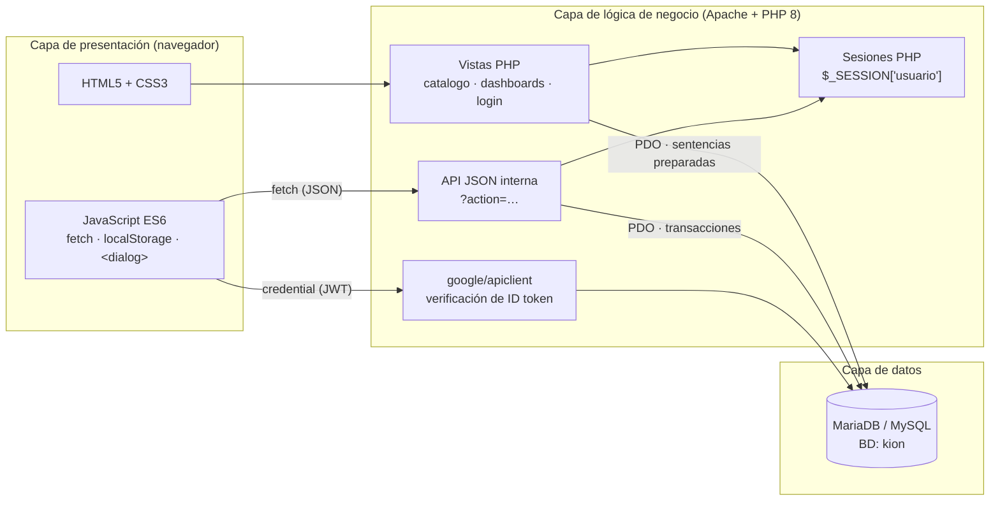
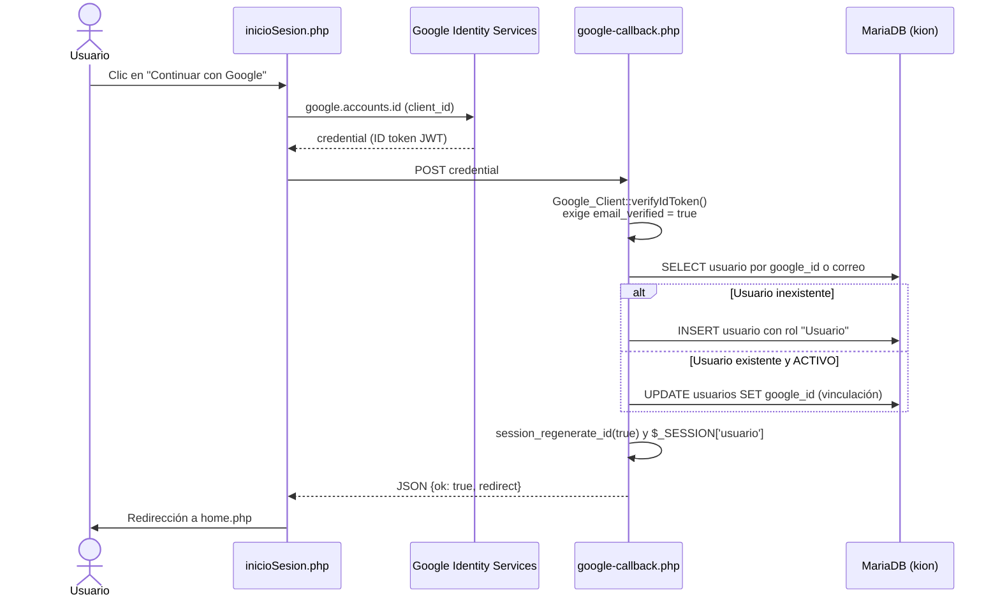
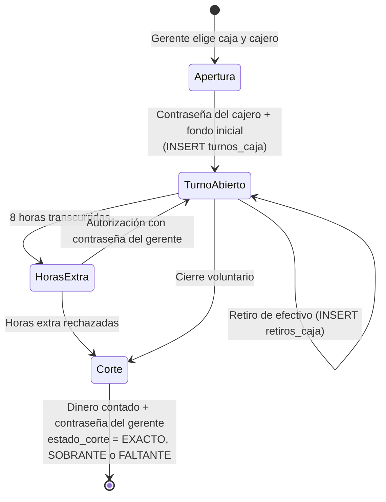
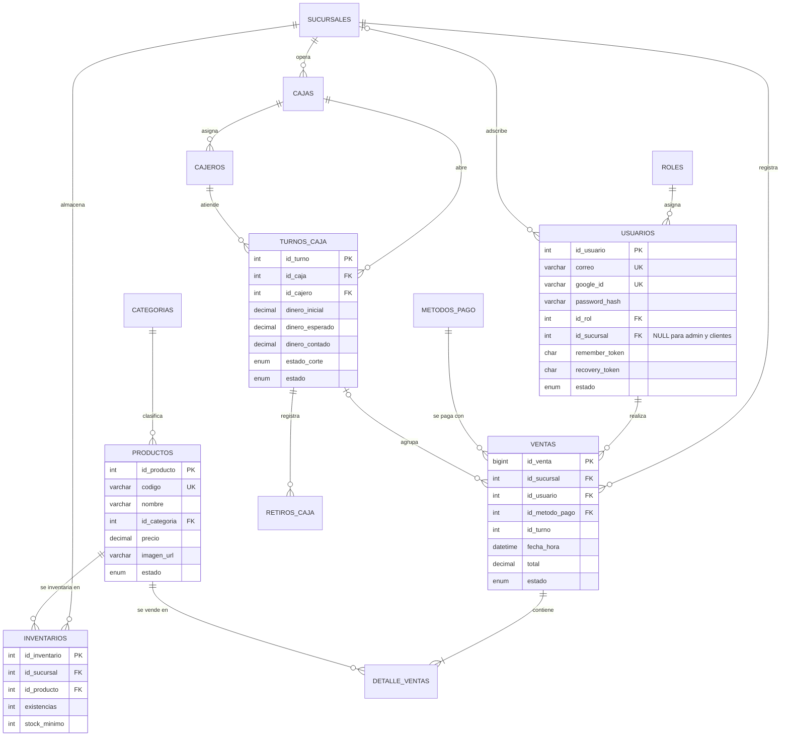

<div align="center">

# PETKO — Sistema de Punto de Venta e Inventario Multisede

*(anteriormente **KION**)*


**PETKO** es una aplicación web centralizada de punto de venta e inventario multisede, diseñada para optimizar la administración operativa, el control de existencias y el registro de ventas en establecimientos del sector veterinario y agropecuario del estado de Colima.


---

**Universidad de Colima** | **Facultad de Ingeniería Electromecánica (FIE)**
*Ingeniería en Software — 3°E*

</div>

---

## Índice

1. [Descripción del proyecto](#1-descripción-del-proyecto)
2. [Integrantes del equipo](#2-integrantes-del-equipo)
3. [Objetivos](#3-objetivos)
4. [Arquitectura del sistema](#4-arquitectura-del-sistema)
5. [Stack tecnológico](#5-stack-tecnológico)
6. [Estructura del directorio](#6-estructura-del-directorio)
7. [Funcionalidades core](#7-funcionalidades-core)
   - 7.1 [Autenticación y control de sesiones](#71-autenticación-y-control-de-sesiones)
   - 7.2 [Control de acceso basado en roles (RBAC)](#72-control-de-acceso-basado-en-roles-rbac)
   - 7.3 [Catálogo dinámico PETKO](#73-catálogo-dinámico-petko)
   - 7.4 [Panel de Administración General](#74-panel-de-administración-general)
   - 7.5 [Panel de Gerente y Punto de Venta](#75-panel-de-gerente-y-punto-de-venta)
   - 7.6 [Panel del Cliente](#76-panel-del-cliente-mi-cuenta)
   - 7.7 [Módulo de Cobranza (prototipo)](#77-módulo-de-cobranza-prototipo)
   - 7.8 [Página de inicio pública](#78-página-de-inicio-pública)
   - 7.9 [Internacionalización, temas y persistencia en el cliente](#79-internacionalización-temas-y-persistencia-en-el-cliente)
8. [Modelo de datos](#8-modelo-de-datos)
9. [Requisitos del sistema](#9-requisitos-del-sistema)
10. [Instalación y configuración](#10-instalación-y-configuración)
11. [Puesta en producción](#11-puesta-en-producción)
12. [Seguridad implementada](#12-seguridad-implementada)
13. [Limitaciones conocidas y trabajo futuro](#13-limitaciones-conocidas-y-trabajo-futuro)

---

## 1. Descripción del proyecto

En el sector veterinario y agropecuario, los negocios combinan la comercialización de productos con servicios de salud e insumos con requerimientos especiales (lotes, caducidades, medicamentos controlados). Con frecuencia operan con registros manuales o con plataformas no interconectadas entre sucursales, lo que provoca inconsistencias en el stock y dificulta la toma de decisiones.

**PETKO** centraliza en una sola base de datos relacional la operación de varias sucursales:

- **Catálogo público** de productos con carrito, apartados y proceso de pedido.
- **Panel de Administración General** con alcance sobre toda la red de sucursales.
- **Panel de Gerente** aislado por sucursal, con inventario, cajas, cajeros, turnos, cortes de caja y un **punto de venta (POS)** integrado.
- **Autenticación** por correo y contraseña o con **cuenta de Google**, con sesiones persistentes y control de acceso por roles.
- Interfaz **bilingüe (español / inglés)** con **modo oscuro**.

---

## 2. Integrantes del equipo

| Integrante |
|---|
| Barba Castillo Ricardo Jafet |
| Hernández Campos Itzel Aranzazu |
| Ibarra Cortés Mía Mariana |
| Juárez Lara Fernando Franco |
| Salgado Zepeda David |

---

## 3. Objetivos

### Objetivo general

Desarrollar e implementar una aplicación web centralizada de punto de venta e inventario multisede, denominada **PETKO** (anteriormente KION), para optimizar la administración operativa de establecimientos comerciales del sector veterinario y agropecuario en el estado de Colima, durante el periodo comprendido entre agosto y noviembre de 2026.

### Objetivos específicos

- Crear interfaces claras e intuitivas para los módulos de administración, inventario y punto de venta, con soporte para dispositivos móviles y de escritorio.
- Diseñar una base de datos relacional normalizada (hasta 3FN) para productos, sucursales, usuarios, inventario y ventas.
- Implementar un sistema de permisos basado en roles de usuario.
- Desarrollar el punto de venta digital con descuento automático de inventario tras cada transacción y generación de tickets.
- Centralizar la administración de sucursales e inventarios diferenciados por sede.
- Probar y desplegar el prototipo funcional en servidores web (IONOS).

---

## 4. Arquitectura del sistema

PETKO sigue una arquitectura **cliente-servidor de tres capas**. Cada página PHP actúa simultáneamente como **vista** (renderizado HTML inicial) y como **controlador** de una API JSON interna, expuesta mediante el parámetro `?action=` y consumida desde JavaScript con `fetch`.



| Capa | Responsabilidad | Tecnologías |
|---|---|---|
| **Presentación** | Renderizado, interacción, validación en cliente, estado local (carrito, apartados, preferencias) | HTML5, CSS3 (Grid, Flexbox, variables CSS, `@property`), JavaScript ES6 sin frameworks |
| **Lógica de negocio** | Autenticación, autorización por rol, reglas de inventario, ventas, turnos y cortes de caja | PHP 8 (`declare(strict_types=1)`), sesiones nativas, Composer |
| **Datos** | Persistencia relacional con integridad referencial | MariaDB 10.4 (motor InnoDB), acceso exclusivo mediante **PDO** |

---

## 5. Stack tecnológico

| Categoría | Tecnología | Uso en el proyecto |
|---|---|---|
| Lenguaje servidor | **PHP 8.1+** | Lógica de negocio, API JSON, sesiones |
| Base de datos | **MariaDB 10.4** (compatible con MySQL) | Almacenamiento relacional, transacciones, claves foráneas |
| Acceso a datos | **PDO** (`pdo_mysql`) | Sentencias preparadas, `ERRMODE_EXCEPTION`, `utf8mb4` |
| Dependencias PHP | **Composer** + `google/apiclient` | Verificación de tokens de Google Sign-In |
| Frontend | HTML5, CSS3, JavaScript ES6 | Interfaz sin frameworks; `<dialog>` nativo, `fetch`, `localStorage` |
| Autenticación externa | **Google Identity Services** | Botón "Continuar con Google" |
| Gráficas | **Chart.js 4.4.1** (CDN) | Ventas de 7 días y métodos de pago en los paneles |
| Diálogos | **SweetAlert2 11** (CDN) | Formularios modales y confirmaciones en los paneles |
| Iconografía | **Phosphor Icons** (CDN) | Iconos de toda la interfaz |
| Tipografía | Google Fonts: Fraunces, Plus Jakarta Sans, Fredoka | Identidad visual |
| Entorno local | **XAMPP** (Apache + MariaDB + PHP), phpMyAdmin | Desarrollo y pruebas |
| Control de versiones | Git y GitHub | Colaboración del equipo |
| Despliegue | IONOS (.mx) | Hosting de pruebas |

### Dependencias de Composer

`composer.json` declara una única dependencia directa; `composer.lock` fija su árbol completo:

| Paquete | Versión fijada | Tipo | PHP requerido |
|---|---|---|---|
| `google/apiclient` | 2.19.4 | Directa | ^8.1 |
| `google/apiclient-services` | 0.459.0 | Transitiva | ^8.1 |
| `google/auth` | 1.54.0 | Transitiva | ^8.1 |
| `firebase/php-jwt` | 7.1.1 | Transitiva (validación de JWT) | ^8.0 |
| `guzzlehttp/guzzle` | 7.15.5 | Transitiva (cliente HTTP) | ^7.2.5 \|\| ^8.0 |
| `monolog/monolog` | 3.12.0 | Transitiva (registro) | >=8.1 |
| `psr/*`, `symfony/*`, `ralouphie/getallheaders` | — | Transitivas (interfaces estándar) | >=8.0 / >=8.1 |

> **Importante:** varias dependencias exigen **PHP 8.1 o superior**. Las versiones de XAMPP con PHP 8.0 no pueden ejecutar `composer install` con este `composer.lock`. Se recomienda **XAMPP 8.2.x** (el volcado SQL del proyecto se generó con PHP 8.2.12).

---

## 6. Estructura del directorio

```text
PETKO/ (raíz del repositorio)
├── index.php                       # Punto de entrada: redirige a src/php/modulos/home/home.php
├── inicioSesion.php                # Login (correo/contraseña, Google, "Recordarme", recuperación)
├── registro.php                    # Alta de cuentas de cliente (rol "Usuario")
├── google-callback.php             # Endpoint JSON: verifica el ID token de Google y crea la sesión
├── cerrarSesion.php                # Destruye la sesión y redirige al login
├── composer.json                   # Dependencias PHP (google/apiclient)
├── composer.lock                   # Versiones exactas del árbol de dependencias
├── .gitignore                      # Excluye vendor/, .env, logs y configuraciones de IDE
├── README.md
│
├── docs/
│   ├── anteproyecto/
│   │   └── Anteproyecto KION.pdf   # Documento formal del anteproyecto
│   ├── base_datos/
│   │   ├── kion.sql                # Volcado del esquema base (9 tablas) y catálogos iniciales
│   │   └── Arbol_de_base_de_datos.txt  # Diagrama textual de tablas y relaciones
│   └── minutas/
│       └── Sem1MinutaEquip2 .pdf   # Minutas de reuniones del equipo
│
└── src/
    ├── css/
    │   ├── catalogo.css            # Sistema de diseño del catálogo PETKO (temas, grid, modales, ticket)
    │   ├── cobranza.css            # Estilos del prototipo de cobranza
    │   ├── dashboard.css           # Sistema de diseño de paneles (reservado; no enlazado actualmente)
    │   └── style.css               # Hoja global heredada (usada por cobranza.php)
    ├── js/
    │   ├── catalogo.js             # Lógica del catálogo: filtros, búsqueda, carrito, apartados, checkout, i18n
    │   ├── cobranza.js             # Carrito y llamadas AJAX del prototipo de cobranza
    │   ├── kion-prefs.js           # Módulo KionPrefs (tema/idioma compartidos; reservado)
    │   └── script.js               # Marcador para JS global
    ├── img/                        # Productos ({id}.jpg), logotipos, iconos y mascotas (perrito, gatos)
    │   └── originales/             # Respaldo de las ilustraciones originales
    ├── videoEJEMPLO/               # Videos de fondo de las pantallas de login y registro
    └── php/
        ├── config/
        │   ├── conexion_BD.php     # Conexión PDO centralizada ($pdo, $errorConexion)
        │   └── conexion.php        # Alias de compatibilidad (require de conexion_BD.php)
        ├── componentes/
        │   ├── catalogo.php        # Catálogo público PETKO (vista principal de clientes)
        │   ├── header.php          # Componente reservado (cabecera compartida)
        │   ├── navbar.php          # Componente reservado (navegación compartida)
        │   └── footer.php          # Componente reservado (pie de página compartido)
        ├── cobranza/
        │   └── cobranza.php        # Prototipo de cobranza (sin base de datos)
        └── modulos/
            └── home/
                ├── home.php                # Landing page pública
                ├── dashboard.php           # Panel de Administración General (+ API ?action=)
                ├── dashboard_gerente.php   # Panel de Gerente + POS, turnos y cortes (+ API ?action=)
                ├── dashboard_usuario.php   # Panel del cliente "Mi Cuenta" (+ API ?action=)
                └── cerrarSesion.php        # Cierre de sesión desde los módulos internos
```

### Descripción de los módulos principales

| Archivo | Tipo | Acceso | Responsabilidad |
|---|---|---|---|
| `index.php` | Enrutador | Público | Redirige al home de la aplicación |
| `inicioSesion.php` | Vista + controlador | Público | Autenticación, CSRF, bloqueo por intentos, "Recordarme", recuperación, Google Sign-In, enrutamiento por rol |
| `registro.php` | Vista + controlador | Público | Registro de clientes con validación de contraseña robusta |
| `google-callback.php` | Endpoint JSON | Público (POST) | Verificación del token de Google, alta o vinculación de la cuenta |
| `src/php/componentes/catalogo.php` | Vista | Público (compra requiere sesión) | Catálogo, carrito, apartados, checkout y ticket |
| `src/php/modulos/home/home.php` | Vista | Público | Página de presentación con accesos según sesión |
| `src/php/modulos/home/dashboard.php` | Vista + API | Administrador | Gestión global: sucursales, personal, catálogo, inventario y ventas |
| `src/php/modulos/home/dashboard_gerente.php` | Vista + API | Gerente | Operación de una sucursal: inventario, productos, cajas, POS y cortes |
| `src/php/modulos/home/dashboard_usuario.php` | Vista + API | Usuario autenticado | Apartados del cliente y cambio de contraseña |
| `src/php/cobranza/cobranza.php` | Vista + API | Prototipo | Maqueta de cobro con datos en sesión |
| `src/php/config/conexion_BD.php` | Configuración | Interno | Crea la instancia `$pdo` compartida |

---

## 7. Funcionalidades core

### 7.1 Autenticación y control de sesiones

La sesión del usuario se representa de forma homogénea en todo el sistema:

```php
$_SESSION['usuario'] = [
    'id_usuario'  => int,
    'nombre'      => string,
    'apellido'    => string,
    'correo'      => string,
    'id_rol'      => int,
    'id_sucursal' => ?int,   // NULL para administradores y clientes
    'rol'         => string, // 'Administrador General' | 'Gerente' | 'Cajero' | 'Usuario'
];
```

#### Inicio de sesión con correo y contraseña (`inicioSesion.php`)

| Mecanismo | Implementación |
|---|---|
| Envío del formulario | `fetch` asíncrono con cabecera `X-Requested-With`; respuesta JSON `{ok, message, redirect}` |
| Protección CSRF | Token aleatorio en `$_SESSION['csrf_token']`, comparado con `hash_equals()` |
| Validación | `FILTER_VALIDATE_EMAIL`, contraseña obligatoria, cuenta en estado `ACTIVO` |
| Verificación | `password_verify()` contra `usuarios.password_hash` (bcrypt) |
| Fuerza bruta | Más de 5 intentos fallidos → bloqueo temporal de 15 minutos (`intentos_login`, `bloqueo_hasta`) |
| Fijación de sesión | `session_regenerate_id(true)` en cada inicio de sesión exitoso |
| "Recordarme" | Cookie `kion_remember` (64 caracteres hex, 30 días, `HttpOnly`, `SameSite=Lax`, `Secure` bajo HTTPS); en la BD se guarda solo su `SHA-256` en `remember_token` con caducidad en `remember_expires_at` |
| Recuperación de contraseña | Genera un token cuyo `SHA-256` se guarda en `recovery_token` (vigencia 1 h); la respuesta es idéntica exista o no el correo, para no revelar qué cuentas existen |

#### Inicio de sesión con Google (`google-callback.php`)



#### Cierre de sesión

`cerrarSesion.php` (en la raíz y en `src/php/modulos/home/`) vacía `$_SESSION`, invalida la cookie de sesión, ejecuta `session_destroy()`, envía cabeceras anti-caché y redirige al login.

#### Modo demostración

`inicioSesion.php` define la constante `DEV_MODE`. Cuando vale `true`, habilita un selector de "rol de demostración" que permite entrar como cualquier usuario activo sin contraseña, pensado para presentaciones del prototipo. **Debe desactivarse en producción** (ver [sección 11](#11-puesta-en-producción)).

### 7.2 Control de acceso basado en roles (RBAC)

| Rol (`roles.nombre`) | Destino tras el login | Alcance | Capacidades principales |
|---|---|---|---|
| **Administrador General** | `dashboard.php` | Toda la red | Sucursales, personal y roles, catálogo global, inventario consolidado, historial de ventas |
| **Gerente** | `dashboard_gerente.php` | Su `id_sucursal` | Inventario y productos de su sede, cajas y cajeros, POS, retiros, turnos y cortes de caja |
| **Cajero** | `dashboard_gerente.php` | Su sucursal | Opera el POS a través de la tabla `cajeros`, con credenciales propias por caja (ver 7.5) |
| **Usuario** (cliente) | `catalogo.php` | Su cuenta | Comprar y apartar en el catálogo; consultar apartados y cambiar contraseña en "Mi Cuenta" |

**Diferencias clave entre Gerente y Usuario:**

- El **Gerente** es personal interno: lo da de alta el Administrador, tiene una sucursal obligatoria y su panel filtra **cada consulta** por el `id_sucursal` leído de la base de datos (no del cliente). Así se garantiza el aislamiento multisede en el servidor.
- El **Usuario** es un cliente: se registra solo (o entra con Google), no tiene sucursal asignada y únicamente interactúa con el catálogo y su panel personal.

La autorización se aplica en el servidor: `dashboard.php` vuelve a consultar el rol en la BD (no confía en la sesión) y rechaza las llamadas AJAX de quien no sea administrador; `dashboard_gerente.php` rechaza las de quien no sea gerente o no tenga sucursal.

### 7.3 Catálogo dinámico PETKO

Archivo: `src/php/componentes/catalogo.php`, con `src/css/catalogo.css` y `src/js/catalogo.js`.

**Obtención de datos (PDO):**

```sql
SELECT p.id_producto, p.nombre, p.precio, c.nombre AS categoria,
       COALESCE(i.existencias, 10) AS stock
FROM productos p
LEFT JOIN categorias  c ON p.id_categoria = c.id_categoria
LEFT JOIN inventarios i ON p.id_producto  = i.id_producto
WHERE p.estado = 'ACTIVO';
```

Las categorías se leen de la tabla `categorias`, y una consulta secundaria opcional obtiene `codigo` y `descripcion` para la vista ampliada. Las imágenes se resuelven por convención (`src/img/{id_producto}.jpg`), con un marcador de posición si no existen.

**Funcionalidades:**

| Funcionalidad | Descripción |
|---|---|
| Filtro por categoría | Barra lateral con iconos por tipo; filtra sin recargar la página y mantiene una URL compartible (`?categoria=`) |
| Búsqueda en vivo | Filtra por nombre mientras se escribe, con estado vacío ilustrado |
| Indicadores de stock | Disponible, "¡Últimas N piezas!" (menos de 10) y Agotado |
| Vista ampliada | Modal nativo `<dialog>` con zoom de imagen, código, descripción, recomendación según la categoría, precio y acciones |
| Carrito lateral | Persistente en `localStorage`, con control de cantidades limitado por el stock y total en MXN |
| Apartados | 1 pieza por producto durante 48 h, con folio `PK-XXXXXX`, caducidad automática y paso de apartado a carrito |
| Checkout | Modal "¿Cómo deseas finalizar tu pedido?" con dos modalidades: **Pagar ahora** (tarjeta o transferencia) y **Apartar y pagar en sucursal** (efectivo) |
| Ticket | Comprobante con folio `FOLIO-####`, fecha, método, estado, partidas y total; vacía el carrito al confirmar |
| Validación de sesión | El servidor publica `window.PETKO_SESION = {autenticado, loginUrl}`; sin sesión, agregar o apartar muestra un aviso y redirige al login |
| Mascota interactiva | Perrito veterinario con globos de diálogo y expresiones según el contexto (éxito, error, búsqueda vacía) |
| Accesibilidad | Escala de texto A− / A / A+ (90 % a 130 %) persistente, navegación por teclado, atributos ARIA y respeto de `prefers-reduced-motion` |
| Diseño | Paleta azul marino, verde y blanco; fondo animado con patrón de huellas; menú lateral fijo (`position: sticky`) con desplazamiento interno |

### 7.4 Panel de Administración General

Archivo: `src/php/modulos/home/dashboard.php`. Interfaz de una sola página (SPA) con barra lateral y API JSON en `dashboard.php?action=…`.

| Vista | Funcionalidad | Operaciones en BD |
|---|---|---|
| **Resumen general** | KPIs (sucursales, personal, productos, ingresos del día), gráfica de ingresos de 7 días, dona de métodos de pago, alertas de stock bajo, valor del inventario | `SELECT` agregados sobre `ventas`, `inventarios`, `productos` |
| **Sucursales** | Alta, edición y estado ACTIVA/INACTIVA | `INSERT` / `UPDATE` en `sucursales` |
| **Personal** | CRUD de administradores, gerentes y cajeros; los roles distintos de administrador exigen sucursal; contraseñas con bcrypt | `INSERT` / `UPDATE` / `DELETE` en `usuarios` |
| **Inventario** | Existencias consolidadas por sucursal con búsqueda y niveles OK / BAJO / AGOTADO | `SELECT` sobre `inventarios` + `productos` + `sucursales` |
| **Catálogo global** | CRUD de productos con imagen por URL y asignación a sucursales | `INSERT` / `UPDATE` en `productos` e `inventarios` **dentro de una transacción** |
| **Ventas** | Historial filtrable por sucursal y fechas, con detalle por venta | `SELECT` sobre `ventas` y `detalle_ventas` |

### 7.5 Panel de Gerente y Punto de Venta

Archivo: `src/php/modulos/home/dashboard_gerente.php`. Todas las consultas filtran por la sucursal del gerente.

| Vista | Funcionalidad |
|---|---|
| **Panel principal** | Ingresos del día, productos con stock bajo, cajas activas, ventas de 7 días |
| **Mi sucursal** | Ficha de la sede |
| **Inventario** | Movimientos de existencias: entrada (suma), salida (resta) y reemplazo |
| **Productos** | Alta (con existencia inicial y stock mínimo de la sede) y edición |
| **Cajas** | Alta y baja de cajas; alta y baja de cajeros por caja con contraseña cifrada |
| **Ventas** | Historial por rango de fechas con detalle |
| **Cortes de caja** | Historial de turnos: inicial, vendido, esperado, contado, diferencia y resultado |
| **Punto de venta** | Flujo completo de cobro (ver diagrama) |

**Ciclo de un turno de caja en el POS:**



- El **efectivo esperado** se calcula como `fondo inicial + ventas en efectivo − retiros`.
- `procesar_venta` toma los precios de la base de datos (no del cliente), valida existencias y registra la venta, sus partidas y el descuento de inventario en una **única transacción**.
- El POS admite lector de código de barras (búsqueda exacta por `codigo`) y búsqueda incremental por nombre.
- Un turno abierto se recupera al recargar la página (`localStorage['kion-gerente-turno']`).

### 7.6 Panel del Cliente ("Mi Cuenta")

Archivo: `src/php/modulos/home/dashboard_usuario.php`. Requiere sesión iniciada.

- **Mis apartados:** listado con producto, sucursal, precio, fecha y estado.
- **Configuración:** datos de la cuenta y cambio de contraseña (verifica la actual con `password_verify` y guarda la nueva con bcrypt).

### 7.7 Módulo de Cobranza (prototipo)

Archivo: `src/php/cobranza/cobranza.php` con `src/js/cobranza.js`. Es una **maqueta funcional sin base de datos**: punto de venta con escaneo de código, historial de pagos y corte de caja. Las ventas se guardan en `$_SESSION['ventas']` y los productos son de demostración. La funcionalidad productiva del POS vive en el Panel de Gerente (7.5).

### 7.8 Página de inicio pública

Archivo: `src/php/modulos/home/home.php`. Página de presentación con secciones de funciones (punto de venta, inventario, multisucursal, personal), ventas, sucursales y roles. Con sesión iniciada muestra el nombre del usuario y un acceso directo al panel que corresponde a su rol.

### 7.9 Internacionalización, temas y persistencia en el cliente

Todas las vistas principales ofrecen **español / inglés** y **modo claro / oscuro**, persistidos en el navegador:

| Clave (`localStorage`) | Módulo | Contenido |
|---|---|---|
| `kion-cart` | Catálogo | Carrito de compras |
| `kion-apartados` | Catálogo | Apartados vigentes (folio y caducidad) |
| `kion-catalog-theme` / `kion-catalog-lang` | Catálogo | Tema e idioma |
| `kion-font-scale` | Catálogo | Escala de texto (0.9–1.3) |
| `kion-admin-theme` / `kion-admin-lang` | Administración | Tema e idioma |
| `kion-gerente-theme` / `kion-gerente-lang` | Gerente | Tema e idioma |
| `kion-gerente-turno` | Gerente (POS) | Turno de caja en curso |
| `kion-user-theme` | Mi Cuenta | Tema |
| `kion_dark` / `kion_lang` | Home | Tema e idioma |

| Cookie | Propósito |
|---|---|
| `PHPSESSID` | Sesión PHP |
| `kion_remember` | Inicio de sesión persistente ("Recordarme") |

---

## 8. Modelo de datos

Base de datos: **`kion`**, codificación `utf8mb4`, motor **InnoDB** con integridad referencial.



| Tabla | Descripción | Claves y restricciones relevantes |
|---|---|---|
| `roles` | Catálogo de roles | `UNIQUE(nombre)` |
| `usuarios` | Cuentas de personal y clientes | `UNIQUE(correo)`, `UNIQUE(google_id)`, FK a `roles` y `sucursales` (`ON DELETE SET NULL`) |
| `sucursales` | Sedes de la red | `UNIQUE(nombre)`, estado ACTIVA/INACTIVA |
| `categorias` | Clasificación de productos | `UNIQUE(nombre)` |
| `productos` | Catálogo global | `UNIQUE(codigo)`, FK a `categorias` |
| `inventarios` | Existencias por sucursal y producto | `UNIQUE(id_sucursal, id_producto)`, `stock_minimo` (predeterminado 5) |
| `metodos_pago` | Efectivo, Tarjeta, Transferencia | `UNIQUE(nombre)` |
| `ventas` | Encabezado de venta | FK a `sucursales`, `usuarios` y `metodos_pago`; estado COMPLETADA/CANCELADA |
| `detalle_ventas` | Partidas de la venta | FK a `ventas` (`ON DELETE CASCADE`) y `productos` |
| `cajas` | Cajas registradoras por sucursal | Fondo base y estado |
| `cajeros` | Operadores de caja con credencial propia | FK a `cajas` y `sucursales` |
| `turnos_caja` | Apertura, cierre y corte de caja | FK a `cajas`, `cajeros` y `sucursales`; resultado EXACTO/SOBRANTE/FALTANTE |
| `retiros_caja` | Retiros de efectivo durante un turno | FK a `turnos_caja` |

> **Nota sobre el volcado:** `docs/base_datos/kion.sql` contiene el **esquema base** (las primeras 9 tablas). Las tablas de caja, el rol `Usuario` y las columnas `usuarios.google_id`, `productos.imagen_url` y `ventas.id_turno` se agregaron durante el desarrollo y se instalan con el script complementario del [paso 4 de la instalación](#paso-4-aplicar-la-migración-complementaria).

---

## 9. Requisitos del sistema

| Componente | Versión mínima | Recomendada | Observaciones |
|---|---|---|---|
| XAMPP | 8.1.x | **8.2.x** | Incluye Apache, MariaDB, PHP y phpMyAdmin |
| PHP | **8.1** | 8.2 | Exigido por `google/apiclient` y `monolog/monolog` |
| MariaDB / MySQL | MariaDB 10.4 | MariaDB 10.4+ | El script de migración usa `IF NOT EXISTS` en `ALTER TABLE` (sintaxis de MariaDB) |
| Composer | 2.x | 2.x | Instalación de dependencias PHP |
| Navegador | Chrome 108, Edge 108, Firefox 128, Safari 16.4 | Última versión | Requiere `<dialog>`, `@property` y unidades `dvh` |
| Conexión a Internet | — | — | Necesaria para CDNs (fuentes, iconos, Chart.js, SweetAlert2) y Google Sign-In |

**Extensiones de PHP requeridas** (habilitadas por defecto en XAMPP):

| Extensión | Motivo |
|---|---|
| `pdo_mysql` | Conexión a la base de datos |
| `openssl` | `random_bytes`, verificación de firmas JWT de Google y HTTPS |
| `mbstring` | Manejo de texto UTF-8 (`mb_strtolower`) |
| `curl` | Cliente HTTP de `guzzlehttp/guzzle` (certificados públicos de Google) |
| `json` | Respuestas de la API interna |

---

## 10. Instalación y configuración

### Paso 1. Obtener el código

Clona el repositorio dentro de `htdocs` de XAMPP (en Windows, con Git Bash):

```bash
cd /c/xampp/htdocs
git clone <URL_DEL_REPOSITORIO> KION
cd KION
```

> La aplicación funciona en cualquier subcarpeta de `htdocs` porque todas las rutas internas son relativas. En esta guía se asume `htdocs/KION`, es decir, `http://localhost/KION/`.

### Paso 2. Instalar las dependencias de PHP

```bash
# Verifica que el PHP en uso sea 8.1 o superior
php -v

# Instala exactamente las versiones fijadas en composer.lock
composer install --no-dev --optimize-autoloader
```

Esto crea la carpeta `vendor/` (excluida del repositorio por `.gitignore`), necesaria para `google-callback.php`.

### Paso 3. Crear la base de datos e importar el esquema base

Inicia **Apache** y **MySQL** desde el panel de control de XAMPP y ejecuta:

```bash
# Crear la base de datos con codificación completa UTF-8
/c/xampp/mysql/bin/mysql.exe -u root -e "CREATE DATABASE IF NOT EXISTS kion CHARACTER SET utf8mb4 COLLATE utf8mb4_unicode_ci;"

# Importar el esquema base y los catálogos iniciales
/c/xampp/mysql/bin/mysql.exe -u root kion < docs/base_datos/kion.sql
```

*Alternativa gráfica:* en `http://localhost/phpmyadmin`, crea la base `kion` con cotejamiento `utf8mb4_unicode_ci` y usa **Importar** con el archivo `docs/base_datos/kion.sql`.

### Paso 4. Aplicar la migración complementaria

El código requiere objetos que no forman parte del volcado base. Ejecuta el siguiente script sobre la base `kion`, desde la pestaña **SQL** de phpMyAdmin o con el cliente de línea de comandos. Es **idempotente**: puede ejecutarse más de una vez sin errores.

```sql
USE kion;

-- 1. Rol para clientes (registro.php y google-callback.php)
INSERT IGNORE INTO roles (id_rol, nombre) VALUES (4, 'Usuario');

-- 2. Columnas usadas por el código y ausentes en el volcado
ALTER TABLE usuarios
    ADD COLUMN IF NOT EXISTS google_id VARCHAR(255) NULL AFTER correo,
    ADD UNIQUE KEY IF NOT EXISTS uq_usuarios_google_id (google_id);

ALTER TABLE productos
    ADD COLUMN IF NOT EXISTS imagen_url VARCHAR(500) NULL AFTER estado;

-- 3. Módulo de cajas, cajeros, turnos y retiros (dashboard_gerente.php)
CREATE TABLE IF NOT EXISTS cajas (
    id_caja        INT(11)       NOT NULL AUTO_INCREMENT,
    nombre         VARCHAR(50)   DEFAULT NULL,
    id_sucursal    INT(11)       DEFAULT NULL,
    fondo_base     DECIMAL(10,2) DEFAULT NULL,
    estado         VARCHAR(20)   DEFAULT 'ACTIVA',
    fecha_registro DATETIME      DEFAULT NULL,
    PRIMARY KEY (id_caja)
) ENGINE=InnoDB DEFAULT CHARSET=utf8mb4 COLLATE=utf8mb4_general_ci;

CREATE TABLE IF NOT EXISTS cajeros (
    id_cajero      INT(11)          NOT NULL AUTO_INCREMENT,
    id_caja        INT(11)          NOT NULL,
    id_sucursal    INT(10) UNSIGNED NOT NULL,
    nombre         VARCHAR(80)      NOT NULL,
    password_hash  VARCHAR(255)     NOT NULL,
    estado         ENUM('ACTIVO','INACTIVO') NOT NULL DEFAULT 'ACTIVO',
    fecha_registro DATETIME         NOT NULL DEFAULT CURRENT_TIMESTAMP,
    PRIMARY KEY (id_cajero),
    KEY idx_cajeros_caja (id_caja),
    KEY idx_cajeros_sucursal (id_sucursal),
    CONSTRAINT fk_cajero_caja     FOREIGN KEY (id_caja)     REFERENCES cajas (id_caja),
    CONSTRAINT fk_cajero_sucursal FOREIGN KEY (id_sucursal) REFERENCES sucursales (id_sucursal)
) ENGINE=InnoDB DEFAULT CHARSET=utf8mb4 COLLATE=utf8mb4_general_ci;

CREATE TABLE IF NOT EXISTS turnos_caja (
    id_turno        INT(11)          NOT NULL AUTO_INCREMENT,
    id_caja         INT(11)          NOT NULL,
    id_cajero       INT(11)          NOT NULL,
    id_sucursal     INT(10) UNSIGNED NOT NULL,
    fecha_inicio    DATETIME         NOT NULL DEFAULT CURRENT_TIMESTAMP,
    fecha_fin       DATETIME         DEFAULT NULL,
    dinero_inicial  DECIMAL(10,2)    NOT NULL DEFAULT 0.00,
    total_vendido   DECIMAL(10,2)    DEFAULT NULL,
    total_retiros   DECIMAL(10,2)    DEFAULT NULL,
    dinero_esperado DECIMAL(10,2)    DEFAULT NULL,
    dinero_contado  DECIMAL(10,2)    DEFAULT NULL,
    diferencia      DECIMAL(10,2)    DEFAULT NULL,
    estado_corte    ENUM('EXACTO','SOBRANTE','FALTANTE') DEFAULT NULL,
    horas_extra     TINYINT(1)       NOT NULL DEFAULT 0,
    estado          ENUM('ABIERTO','CERRADO') NOT NULL DEFAULT 'ABIERTO',
    PRIMARY KEY (id_turno),
    KEY idx_turnos_caja (id_caja),
    KEY idx_turnos_cajero (id_cajero),
    KEY idx_turnos_sucursal (id_sucursal),
    CONSTRAINT fk_turno_caja     FOREIGN KEY (id_caja)     REFERENCES cajas (id_caja),
    CONSTRAINT fk_turno_cajero   FOREIGN KEY (id_cajero)   REFERENCES cajeros (id_cajero),
    CONSTRAINT fk_turno_sucursal FOREIGN KEY (id_sucursal) REFERENCES sucursales (id_sucursal)
) ENGINE=InnoDB DEFAULT CHARSET=utf8mb4 COLLATE=utf8mb4_general_ci;

CREATE TABLE IF NOT EXISTS retiros_caja (
    id_retiro INT(11)       NOT NULL AUTO_INCREMENT,
    id_turno  INT(11)       NOT NULL,
    monto     DECIMAL(10,2) NOT NULL,
    motivo    VARCHAR(255)  DEFAULT NULL,
    fecha     DATETIME      NOT NULL DEFAULT CURRENT_TIMESTAMP,
    PRIMARY KEY (id_retiro),
    KEY idx_retiros_turno (id_turno),
    CONSTRAINT fk_retiro_turno FOREIGN KEY (id_turno) REFERENCES turnos_caja (id_turno)
) ENGINE=InnoDB DEFAULT CHARSET=utf8mb4 COLLATE=utf8mb4_general_ci;

-- 4. Vincular cada venta con el turno de caja en que se cobró
ALTER TABLE ventas
    ADD COLUMN IF NOT EXISTS id_turno INT(11) NULL AFTER estado;
```

### Paso 5. Configurar las credenciales de la base de datos

La conexión centralizada está en `src/php/config/conexion_BD.php`. Por defecto usa la configuración estándar de XAMPP:

```php
$dbHost = 'localhost';
$dbName = 'kion';
$dbUser = 'root';
$dbPass = '';
```

La conexión se crea con estas opciones de PDO:

| Opción | Valor | Propósito |
|---|---|---|
| DSN | `mysql:host=…;dbname=kion;charset=utf8mb4` | Codificación UTF-8 completa (acentos, emojis) |
| `PDO::ATTR_ERRMODE` | `ERRMODE_EXCEPTION` | Los errores lanzan `PDOException` |
| `PDO::ATTR_DEFAULT_FETCH_MODE` | `FETCH_ASSOC` | Resultados como arreglos asociativos |
| `PDO::ATTR_EMULATE_PREPARES` | `false` | Sentencias preparadas nativas del servidor |

Si tu servidor usa otras credenciales, edita **ambos** archivos que definen la conexión:

| Archivo | Líneas |
|---|---|
| `src/php/config/conexion_BD.php` | Variables `$dbHost`, `$dbName`, `$dbUser`, `$dbPass` |
| `src/php/componentes/catalogo.php` | Bloque "Conexión PDO básica para XAMPP local" al inicio del archivo |

`src/php/config/conexion.php` es un alias que solo incluye `conexion_BD.php`; no requiere cambios.

### Paso 6. Configurar Google Sign-In (opcional)

1. En [Google Cloud Console](https://console.cloud.google.com/apis/credentials), crea un **ID de cliente de OAuth 2.0** de tipo *Aplicación web*.
2. En **Orígenes de JavaScript autorizados** agrega `http://localhost` (y el dominio de producción).
3. Reemplaza el *Client ID* en los dos lugares donde se usa:

| Archivo | Ubicación |
|---|---|
| `inicioSesion.php` | `const googleClientId = '…';` |
| `google-callback.php` | `new Google_Client(['client_id' => '…'])` |

### Paso 7. Crear los usuarios iniciales

El volcado no incluye usuarios. Genera un hash de contraseña compatible con `password_verify()`:

```bash
php -r "echo password_hash('Admin#2026', PASSWORD_DEFAULT), PHP_EOL;"
```

Después inserta una sucursal, un administrador y un gerente, sustituyendo `<HASH_GENERADO>` por el resultado anterior:

```sql
USE kion;

INSERT INTO sucursales (nombre, direccion, telefono, contacto)
VALUES ('Matriz Colima', 'Av. Principal #100, Colima, Col.', '3120000000', 'matriz@petko.mx');

-- El administrador no lleva sucursal; el gerente debe tener una
INSERT INTO usuarios (nombre, apellido, correo, password_hash, id_rol, id_sucursal, estado) VALUES
('Admin',   'PETKO',  'admin@petko.mx',   '<HASH_GENERADO>', 1, NULL,             'ACTIVO'),
('Gerente', 'Matriz', 'gerente@petko.mx', '<HASH_GENERADO>', 2, LAST_INSERT_ID(), 'ACTIVO');
```

Los clientes (rol `Usuario`) se registran por su cuenta desde `registro.php` o con Google. Los productos, el inventario por sucursal, las cajas y los cajeros se dan de alta desde los paneles de Administración y de Gerente.

### Paso 8. Acceder al sistema

| Recurso | URL |
|---|---|
| Inicio | `http://localhost/KION/` |
| Inicio de sesión | `http://localhost/KION/inicioSesion.php` |
| Registro | `http://localhost/KION/registro.php` |
| Catálogo | `http://localhost/KION/src/php/componentes/catalogo.php` |
| phpMyAdmin | `http://localhost/phpmyadmin` |

### Lista de verificación

- [ ] `php -v` muestra la versión 8.1 o superior y existe la carpeta `vendor/`.
- [ ] La base `kion` tiene 13 tablas (`SHOW TABLES;`) y el rol `Usuario` existe.
- [ ] El catálogo carga sin el mensaje "Fallo al conectar con la base de datos".
- [ ] `admin@petko.mx` entra a `dashboard.php` y `gerente@petko.mx` a `dashboard_gerente.php`.
- [ ] Un cliente registrado en `registro.php` puede iniciar sesión y es enviado al catálogo.

---

## 11. Puesta en producción

Antes de desplegar en un servidor público (por ejemplo, IONOS):

1. **Desactivar el modo demostración** en `inicioSesion.php`:
   ```php
   define('DEV_MODE', false);
   ```
2. **Crear un usuario de base de datos dedicado** con privilegios mínimos, en lugar de `root` sin contraseña:
   ```sql
   CREATE USER 'petko_app'@'localhost' IDENTIFIED BY '<CONTRASEÑA_SEGURA>';
   GRANT SELECT, INSERT, UPDATE, DELETE ON kion.* TO 'petko_app'@'localhost';
   FLUSH PRIVILEGES;
   ```
   Y actualizar las credenciales en los dos archivos del [paso 5](#paso-5-configurar-las-credenciales-de-la-base-de-datos).
3. **Servir el sitio por HTTPS.** La cookie `kion_remember` activa el atributo `Secure` automáticamente.
4. **Registrar el dominio de producción** en los orígenes autorizados de Google.
5. **Ocultar errores de PHP al usuario** (`display_errors = Off`) y conservar `log_errors = On`. La capa de conexión ya registra los fallos con `error_log()` sin exponer detalles.

---

## 12. Seguridad implementada

| Amenaza | Contramedida | Ubicación |
|---|---|---|
| Inyección SQL | Sentencias preparadas de PDO con `EMULATE_PREPARES = false` | Todo el backend |
| Robo de contraseñas | `password_hash()` (bcrypt) y `password_verify()` | Login, registro, paneles, cajeros |
| CSRF en autenticación | Token de sesión verificado con `hash_equals()` | `inicioSesion.php`, `registro.php` |
| Fuerza bruta | Bloqueo de 15 minutos tras 5 intentos fallidos | `inicioSesion.php` |
| Fijación de sesión | `session_regenerate_id(true)` al autenticar | Login y callback de Google |
| Robo de token persistente | Solo se almacena el `SHA-256` del token; la cookie es `HttpOnly` y `SameSite=Lax` | "Recordarme" |
| Enumeración de cuentas | Respuesta idéntica en la recuperación de contraseña | `inicioSesion.php` |
| Suplantación con Google | Verificación de firma del ID token y exigencia de `email_verified` | `google-callback.php` |
| XSS | `htmlspecialchars()` en PHP; `textContent` y `escapeHtml()` en JavaScript | Vistas y paneles |
| Acceso entre sucursales | `id_sucursal` leído de la BD y aplicado en cada consulta del gerente | `dashboard_gerente.php` |
| Manipulación de precios | El POS toma los precios de la BD dentro de una transacción | `procesar_venta` |
| Caché de páginas privadas | Cabeceras `Cache-Control: no-store` en paneles y cierre de sesión | Dashboards, `cerrarSesion.php` |

---

## 13. Limitaciones conocidas y trabajo futuro

El proyecto es un **prototipo académico en desarrollo activo**. Se documentan con transparencia los puntos identificados durante la revisión técnica:

| Área | Situación actual | Mejora propuesta |
|---|---|---|
| Catálogo multisede | La consulta une `inventarios` sin filtrar por sucursal, por lo que un producto aparece una vez por cada sede donde existe | Agregar existencias por producto (`SUM`) o permitir elegir sucursal |
| Pedidos del catálogo | Carrito, apartados, checkout y ticket son simulados en el navegador (`localStorage`); la validación de sesión es solo del lado del cliente | Endpoint PHP que registre pedidos y apartados en la BD validando `$_SESSION` |
| Panel del cliente | Consulta una tabla `apartados` que aún no existe; la vista muestra una lista vacía | Crear la tabla y conectarla con el catálogo |
| IVA en el POS | La interfaz muestra un IVA del 16 %, pero `ventas.total` se guarda sin él | Persistir subtotal, impuesto y total |
| CSRF en paneles | Las acciones AJAX de los dashboards no validan token | Reutilizar `$_SESSION['csrf_token']` en todas las peticiones POST |
| Rol Cajero | El login envía a los cajeros al panel de gerente, cuya API solo admite gerentes; en la práctica los cajeros operan mediante la tabla `cajeros` en el POS | Definir un panel propio de cajero o unificar el modelo |
| Recuperación de contraseña | Genera y guarda el token, pero no envía el correo | Integrar un servicio SMTP (por ejemplo, PHPMailer) y una página de restablecimiento |
| Cierre de sesión | No revoca la cookie `kion_remember` | Limpiar el token en BD y la cookie al cerrar sesión |
| Concurrencia en ventas | No se usa `SELECT … FOR UPDATE` al descontar inventario | Bloqueo de filas dentro de la transacción |
| Configuración | Credenciales duplicadas en dos archivos | Centralizar en `conexion_BD.php` o en variables de entorno (`.env`, ya excluido en `.gitignore`) |
| Componentes compartidos | `header.php`, `navbar.php`, `footer.php`, `script.js`, `kion-prefs.js` y `dashboard.css` están reservados y aún no se incluyen | Extraer la cabecera, la navegación y las preferencias comunes de las vistas |
| Pruebas | No hay pruebas automatizadas | Pruebas unitarias con PHPUnit para las reglas de negocio (ventas, cortes) |

---

<div align="center">

**PETKO** — Proyecto académico · Universidad de Colima · Facultad de Ingeniería Electromecánica · 2026

</div>
